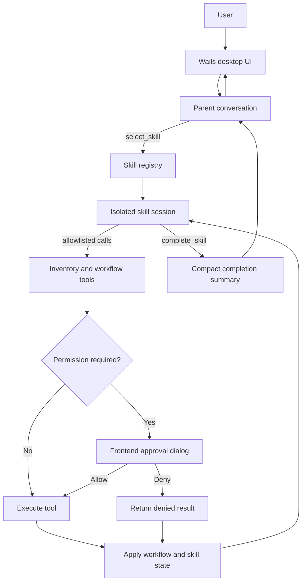

# AIMS2

[](https://github.com/gamershoney/AIMS2/actions/workflows/ci.yml)
[](LICENSE)

**A supervised agentic desktop assistant for inventory and purchasing workflows.**

AIMS2 is an independent engineering portfolio project exploring how a smaller, locally hosted language model can complete multi-step business tasks without being overwhelmed by database results or long tool histories.

I built the application around a Go workflow runner, SQLite inventory tools, Markdown-defined skills, explicit state, and a Wails desktop interface. The model can investigate inventory and prepare purchasing work, while deterministic code controls which tools are available, how much data enters context, and when execution must pause for user approval.

> [!NOTE]
> This repository is presented as a resume and engineering case-study project. It demonstrates a working supervised-agent architecture, but it is not a production purchasing system and cannot place orders.

## Project snapshot

| Area | Implementation |
| --- | --- |
| Backend | Go, SQLite, HTTP APIs, structured tool registry |
| Desktop UI | Wails, JavaScript, HTML, CSS |
| Agent runtime | Multi-round tool loop, isolated skill sessions, bounded steps |
| Context strategy | Compact discovery results, on-demand details, state slots, history compaction |
| Safety | Per-tool permission classification and frontend Allow/Deny workflow |
| Quality | 30+ Go tests, synthetic database fixtures, CI, environment-based configuration |

## What this project demonstrates

- Designing an agent loop instead of wrapping a model in a single chat request
- Separating model judgment from deterministic application behavior
- Managing limited context windows with selective retrieval and compaction
- Building explicit workflow state that survives individual model/tool rounds
- Isolating workflows with skill-specific prompts, tools, and step limits
- Enforcing a human approval boundary in code rather than relying only on prompting
- Integrating Go, SQLite, HTTP services, and a desktop JavaScript frontend
- Testing orchestration, state propagation, tool restrictions, and permission behavior

## The engineering problem

The first version exposed inventory tools directly to the model. That worked for simple questions, but deeper tasks revealed two problems:

1. Broad inventory and web-search results consumed too much of a smaller model's context window.
2. Long conversations left the model responsible for remembering workflow progress and safety rules from raw history.

AIMS2 addresses those constraints with a layered design:

- `stock_check` returns compact candidates rather than complete inventory records.
- `item_details` loads commercial fields only after the workflow identifies one item.
- Large tool responses are capped before entering model context.
- Old raw tool messages are removed after their active turn.
- Workflow progress is stored in reserved state messages.
- Skills run in isolated child conversations with only their allowed tools.
- State-changing tools pause until the user approves or denies the stored call.

## Architecture



The model proposes actions. Go code owns tool registration, response limits, tool allowlists, state application, maximum steps, and permission enforcement.

## Representative workflow

For a request such as “review this item and save a critical inventory note”:

1. The parent model selects the permission workflow from the skill catalog.
2. A child chat starts with the skill instructions and only its allowed tools.
3. The skill resolves the item through compact search and exact detail lookup.
4. The model calls the state-changing note tool with exact arguments.
5. Go stores the pending call without executing it.
6. The frontend displays the tool, workflow, and proposed arguments.
7. Approval executes the stored call; denial returns a safe, model-visible result.
8. The child skill completes and returns a concise summary to the parent chat.

## Key design decisions

| Problem | Decision | Tradeoff |
| --- | --- | --- |
| Inventory results consumed too much context | Split broad discovery from exact detail retrieval | Some questions require an additional tool round |
| Raw history was unreliable workflow memory | Store compact workflow and skill state in reserved messages | State is currently process-local rather than durable |
| General chat exposed too many tools | Run selected skills in isolated conversations with allowlists | Skill definitions require deliberate maintenance |
| Prompt-only approval was too weak | Classify tools in Go and pause restricted calls before execution | The workflow requires an explicit user interaction |
| Tool loops could run indefinitely | Enforce skill-specific `max_steps` | Complex workflows may need to stop and explain partial progress |
| Tests depended on private inventory data | Replace it with temporary SQLite databases and synthetic fixtures | Fixtures cover behavior, not production data quality |

## Current capabilities

- Multi-round model and tool execution
- Compact inventory search with confidence and note signals
- Exact item detail lookup for price, cost, vendor, usage, and transaction dates
- Vendor-priority summaries and optional public web search
- Markdown skill parsing with metadata and full procedural bodies
- Skill-specific tool allowlists and maximum step counts
- In-memory workflow state, warnings, summaries, and pending actions
- Frontend permission dialog that resumes or denies paused tool calls
- Context compaction and maximum tool-response sizes
- Configurable model, endpoint, timeout, data paths, and logging behavior

## Testing and validation

The Go suite contains more than 30 tests covering areas such as:

- compact inventory response schemas and note signals;
- workflow-state and skill-state propagation;
- context compaction behavior;
- skill parsing, registration, selection, isolation, and completion;
- rejection of disallowed tools;
- permission gating before tool execution;
- approval resumption through the frontend-facing API; and
- temporary database creation, inventory search, notes, and vendor ranking.

Continuous integration runs the Go suite and frontend production build. Local validation commands are:

```sh
cd AIMS2
go test ./...
go vet ./...
cd frontend
npm run build
```

## Current limitations and next steps

The workflow foundation is working, but several production concerns are intentionally unfinished:

- Workflow state is in memory and cannot yet resume across application restarts.
- Reorder quantities and purchase recommendations still need deterministic business tools.
- Authentication, user roles, and durable audit records are not implemented.
- Tool failures need stronger retry and recovery policies.
- The system does not submit, email, or place purchase orders.
- End-to-end workflow evaluations are still being expanded.

The detailed implementation plan is tracked in the [agentic workflow roadmap](AIMS2/AGENTIC_WORKFLOW_ROADMAP.md).

## Run locally

<details>
<summary>Prerequisites and setup</summary>

### Prerequisites

- Go 1.25 or later
- Node.js 22 or later and npm
- [Wails v2](https://wails.io/docs/gettingstarted/installation)
- An Ollama-compatible endpoint and tool-capable model

### Setup

```sh
git clone https://github.com/gamershoney/AIMS2.git
cd AIMS2/AIMS2

cd frontend
npm ci
cd ..

export AIMS2_MODEL_API_URL=http://localhost:11434/api/
export AIMS2_MODEL=your-tool-capable-model

wails dev
```

AIMS2 reads configuration from the process environment and does not automatically load `.env` files. See [`.env.example`](AIMS2/.env.example) for all settings.

The application creates an empty SQLite database when the configured database is missing. Meaningful inventory queries require a local database matching the [included schema](AIMS2/importer/schema.sql). Real inventory data is intentionally excluded from this repository.

</details>

## Repository guide

| Path | Purpose |
| --- | --- |
| `AIMS2/app.go` | Wails bridge and frontend permission API |
| `AIMS2/handler.go` | Parent and skill model/tool execution loops |
| `AIMS2/context.go` | Context compaction, state, and skill registry |
| `AIMS2/tools.go` | Tool interfaces, registry, and implementations |
| `AIMS2/skills/` | Markdown-defined workflow procedures |
| `AIMS2/importer/` | SQLite schema, inventory queries, notes, and import support |
| `AIMS2/frontend/` | Desktop chat interface and approval dialog |
| `AIMS2/tools_test.go` | Agent, tool, state, and permission tests |

Additional technical documentation:

- [Application configuration](AIMS2/README.md)
- [Agentic workflow roadmap](AIMS2/AGENTIC_WORKFLOW_ROADMAP.md)
- [Security and data-handling notes](AIMS2/SECURITY.md)

## Security and data privacy

AIMS2 can process inventory, price, cost, note, vendor, prompt, and tool-result data. Relevant messages and tool results are sent to the configured model service even when SQLite remains local.

Conversation logging is disabled by default, and model payloads are not printed to stdout. Credentials, private endpoints, databases, spreadsheets, and logs are configured or stored outside source control. The permission gate is a supervised workflow safeguard, not a replacement for production authentication or authorization.

## License

This portfolio project is available under the [MIT License](LICENSE).
