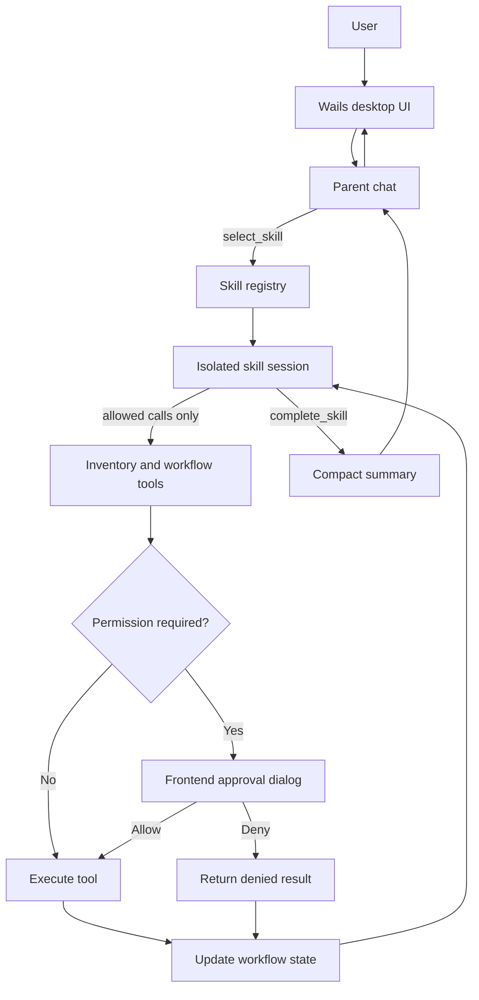

# AIMS2

[](https://github.com/gamershoney/AIMS2/actions/workflows/ci.yml)
[](LICENSE)

AIMS2 is an experimental desktop inventory assistant for building supervised, agentic purchasing workflows with locally controlled tools and data.

It combines a Go backend, a Wails desktop interface, an Ollama-compatible model endpoint, compact inventory tools, and Markdown-defined workflow skills. The agent can investigate inventory and prepare draft purchasing work while code-level permission gates pause state-changing tools for explicit user approval.

> [!IMPORTANT]
> AIMS2 is under active development. It is intended for local development and supervised evaluation—not unattended purchasing, production inventory control, or autonomous order placement.

## Why AIMS2?

Large inventory datasets and long tool transcripts quickly overwhelm smaller model context windows. AIMS2 is designed around a narrower workflow:

- broad searches return compact candidates instead of full database rows;
- detailed commercial data is loaded only for selected items;
- workflow progress is stored in explicit state instead of raw conversation history;
- each skill runs in an isolated conversation with a bounded tool allowlist;
- state-changing tools stop at a code-enforced permission boundary; and
- completed skills return concise summaries to the parent conversation.

## Current capabilities

- Multi-round model and tool execution
- Compact inventory search with confidence and note signals
- Exact item detail lookup for price, cost, vendor, usage, and transaction dates
- Vendor-priority summaries
- Optional public web search
- Markdown-defined skills with metadata, procedures, tool allowlists, and step limits
- Isolated skill sessions with in-memory job and workflow state
- Frontend Allow/Deny popup for permission-gated tool calls
- Context compaction and maximum tool-response sizes
- Synthetic, temporary database fixtures for tests

The next major work is deterministic reorder analysis, typed order-draft state, durable workflow resumption, and end-to-end business evaluations. See the [agentic workflow roadmap](AIMS2/AGENTIC_WORKFLOW_ROADMAP.md).

## Architecture



The model chooses actions, but Go code owns tool registration, response limits, state application, allowed-tool enforcement, step limits, and permission checks.

## Quick start

### Prerequisites

- Go 1.25 or later
- Node.js 22 or later and npm
- [Wails v2](https://wails.io/docs/gettingstarted/installation)
- An Ollama-compatible chat endpoint and a tool-capable model

Clone the repository and enter the application directory:

```sh
git clone https://github.com/gamershoney/AIMS2.git
cd AIMS2/AIMS2
```

Install frontend dependencies:

```sh
cd frontend
npm ci
cd ..
```

Configure the model endpoint and model name. Defaults target a local Ollama-compatible server:

```sh
export AIMS2_MODEL_API_URL=http://localhost:11434/api/
export AIMS2_MODEL=your-tool-capable-model
```

Run in development mode:

```sh
wails dev
```

The app creates an empty SQLite database when the configured database does not exist. Inventory queries require your own local database matching [the included schema](AIMS2/importer/schema.sql).

## Configuration

AIMS2 reads configuration from the process environment; it does not automatically load `.env` files. See [`.env.example`](AIMS2/.env.example) for a copyable reference.

| Variable | Purpose | Default |
| --- | --- | --- |
| `AIMS2_MODEL_API_URL` | Ollama-compatible API base URL | `http://localhost:11434/api/` |
| `AIMS2_MODEL` | Chat model name | `gemma4:12b` |
| `AIMS2_KEEP_ALIVE` | Model keep-alive setting | `5m` |
| `AIMS2_HTTP_TIMEOUT` | Outbound HTTP timeout | `2m` |
| `OLLAMA_API_KEY` | Optional Ollama web-search credential | unset |
| `AIMS2_WEB_SEARCH_API_URL` | Web-search endpoint | Ollama web search |
| `AIMS2_INVENTORY_DB_PATH` | Local SQLite inventory database | `./importer/inventory.db` |
| `AIMS2_INVENTORY_IMPORT_PATH` | Spreadsheet path for importer development | unset |
| `AIMS2_EXCLUDED_VENDOR_CODES` | Vendor codes excluded from priority ranking | unset |
| `AIMS2_CONVERSATION_LOG` | Opt-in NDJSON conversation log path | disabled |
| `AIMS2_DEBUG_MODEL_PAYLOADS` | Print complete model payloads | `false` |

## Skills and permission boundaries

Skills live in `AIMS2/skills/<skill-name>/SKILL.md`. YAML frontmatter defines the skill name, description, allowed tools, maximum steps, approval metadata, and final schema. The Markdown body contains the procedure and rules supplied to the isolated skill conversation.

Tools implement a Go permission classification. When a permission-required tool is called, AIMS2 stores the exact pending tool and arguments, pauses execution, and displays them in the frontend. Approval executes that stored call; denial returns a model-visible denied result without running it.

The current permission gate is an important supervised-workflow boundary, but it is not authentication or authorization. Production deployments still need user identity, role checks, least-privilege database access, audit policy, and operational controls.

## Privacy and data handling

AIMS2 may process inventory levels, prices, costs, notes, vendor information, model prompts, and tool results. Although the SQLite database is local, relevant prompts and tool results are sent to the configured model service.

- Never commit credentials, inventory databases, spreadsheet exports, or conversation logs.
- Conversation logging is disabled unless `AIMS2_CONVERSATION_LOG` is explicitly set.
- Full model payload output is disabled unless `AIMS2_DEBUG_MODEL_PAYLOADS=true`.
- Use synthetic fixtures in tests and examples.
- Review the privacy and retention policy of any remote model or search provider.

Read the [security policy](AIMS2/SECURITY.md) before connecting AIMS2 to private business data.

## Development and validation

From the repository root, run the complete Go test suite:

```sh
cd AIMS2
go test ./...
go vet ./...
```

Build the frontend:

```sh
cd AIMS2/frontend
npm run build
```

Build the desktop application from `AIMS2/`:

```sh
wails build
```

Continuous integration runs Go tests and the frontend build for pushes and pull requests.

## Repository layout

| Path | Purpose |
| --- | --- |
| `AIMS2/app.go` | Wails application bridge and permission API |
| `AIMS2/handler.go` | Parent and skill model/tool execution loops |
| `AIMS2/context.go` | Context compaction, workflow state, and skill registry |
| `AIMS2/tools.go` | Tool registry and inventory tool implementations |
| `AIMS2/skills/` | Markdown-defined workflow skills |
| `AIMS2/importer/` | SQLite schema, inventory queries, notes, and import support |
| `AIMS2/frontend/` | Desktop chat interface and permission dialog |
| `AIMS2/AGENTIC_WORKFLOW_ROADMAP.md` | Implementation status and planned milestones |

## Troubleshooting

### Model connection timeout

Confirm that `AIMS2_MODEL_API_URL` is reachable from the machine running AIMS2 and includes the `/api/` base path. For a default local Ollama installation:

```sh
curl http://localhost:11434/api/tags
```

An `i/o timeout` while dialing means AIMS2 did not establish a TCP connection; check the server process, host, port, routing, VPN, and firewall.

### Web search is not configured

Set `OLLAMA_API_KEY` in the application process environment. The key is optional unless the model selects the web-search tool.

### Inventory searches return no matches

Check `AIMS2_INVENTORY_DB_PATH` and confirm the database contains inventory rows matching [the expected schema](AIMS2/importer/schema.sql). A new database starts empty.

## Project documentation

- [Application setup reference](AIMS2/README.md)
- [Agentic workflow roadmap](AIMS2/AGENTIC_WORKFLOW_ROADMAP.md)
- [Public release checklist](AIMS2/PUBLIC_RELEASE_CHECKLIST.md)
- [Contributing guide](AIMS2/CONTRIBUTING.md)
- [Security policy](AIMS2/SECURITY.md)

## Contributing

Contributions are welcome. Please read [CONTRIBUTING.md](AIMS2/CONTRIBUTING.md) and keep all examples and tests synthetic.

## License

AIMS2 is available under the [MIT License](LICENSE).
